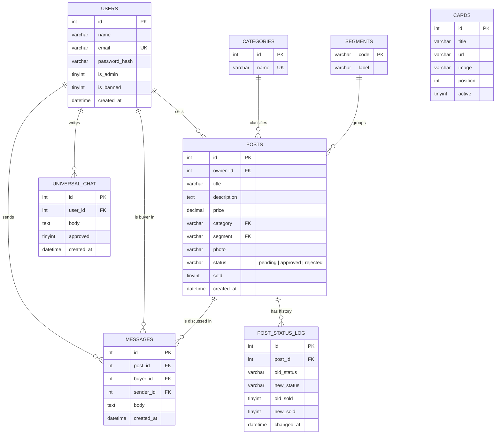

# SoldNSU — Database Design

## 1. ER diagram

GitHub renders this Mermaid diagram automatically.

`CARDS` stands alone: it holds the quick-link cards on the home page and has no relationship with the other tables.

## 2. Relational schema

Primary keys are **bold**, foreign keys are *italic*.

- segments(**code**, label)
- categories(**id**, name UNIQUE)
- users(**id**, name, email UNIQUE, password_hash, is_admin, is_banned, created_at)
- posts(**id**, *owner_id* → users.id, title, description, price, *category* → categories.name, *segment* → segments.code, photo, status, sold, created_at)
- messages(**id**, *post_id* → posts.id, *buyer_id* → users.id, *sender_id* → users.id, body, created_at)
- universal_chat(**id**, *user_id* → users.id, body, approved, created_at)
- cards(**id**, title, url, image, position, active)
- post_status_log(**id**, *post_id* → posts.id, old_status, new_status, old_sold, new_sold, changed_at)

## 3. Cardinality and participation

| Relationship | Cardinality | Notes |
|---|---|---|
| user sells post | 1 : N | every post must have an owner (total participation of posts) |
| category classifies post | 1 : N | a category may have no posts yet |
| segment groups post | 1 : N | only two segments: `university`, `universal` |
| post has messages | 1 : N | one conversation = all messages with the same (post_id, buyer_id) |
| user writes universal_chat | 1 : N | shown to everyone only after an admin approves it |
| post has status-log rows | 1 : N | rows are written by triggers, never by the app |

## 4. Normalization

**1NF.** Every column holds one atomic value; there are no repeating groups (a post has one photo, one category, one segment). Each table has a primary key.

**2NF.** All primary keys are single-column surrogate or natural keys, so no attribute can depend on only part of a key.

**3NF.** No non-key attribute depends on another non-key attribute:
- The first version stored the category name and segment label as free text inside `posts`, so a typo created a "new" category and the segment label depended on the segment code. The labels now live in `segments` and the category names in `categories`; `posts` only stores the key, enforced by a foreign key.
- The seller's name is not copied into `posts` or `messages`; it is joined from `users` when needed.
- Statistics (post counts, sold value, …) are not stored; they are computed by views.

## 5. Integrity constraints

| Constraint | Where | What it stops |
|---|---|---|
| `UNIQUE(email)` | users | two accounts with one e-mail |
| `fk_posts_owner` | posts | a post without an existing owner |
| `fk_posts_category`, `fk_posts_segment` | posts | unknown categories / segments |
| `chk_posts_price` (+ trigger) | posts | negative prices |
| `chk_posts_status` | posts | any status except pending / approved / rejected |
| `CHECK (x IN (0,1))` | flags | invalid boolean values |
| `ON DELETE CASCADE` | messages, universal_chat, post_status_log | orphan rows when a post or user is deleted |

## 6. Indexes

| Index | Used by |
|---|---|
| `idx_posts_browse (status, segment, category)` | home page filters |
| `idx_posts_created (created_at)` | date reports |
| `idx_msg_thread (post_id, buyer_id, id)` | loading one conversation in order |
| `idx_uchat_approved (approved, id)` | universal chat and the moderation queue |

## 7. Views, triggers and procedures

| Object | Type | Purpose |
|---|---|---|
| `v_active_listings` | view | approved, unsold posts with seller and segment label |
| `v_category_summary` | view | posts, live, sold, min/avg/max price per category |
| `v_seller_stats` | view | per-member activity and sold value |
| `v_segment_summary` | view | pending/approved/rejected per segment |
| `trg_users_before_insert` | trigger | lower-cases and trims e-mail |
| `trg_posts_before_insert` | trigger | rejects negative price with `SIGNAL` |
| `trg_posts_insert_audit`, `trg_posts_status_audit` | triggers | fill `post_status_log` |
| `sp_approve_post` | procedure | approve one post |
| `sp_seller_report` | procedure | one seller's posts and interested buyers |
| `sp_search_posts` | procedure | keyword / segment / max-price search |

The admin **Reports** page in the app reads the views and the audit log directly.
